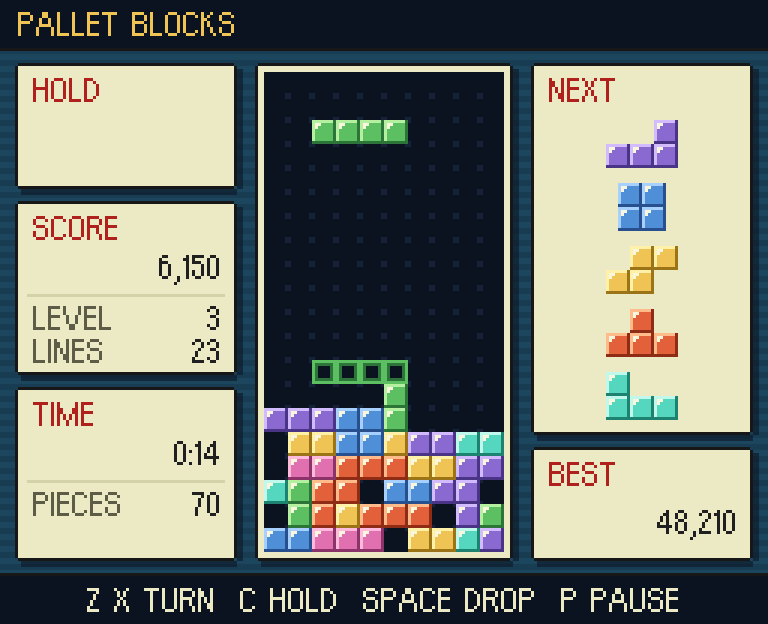

# Pallet Blocks

A falling-blocks puzzle game in handheld pixel art, made for the games console in
the house in [Escape from Pallet Town](https://github.com/OllySalanson/escape-from-pallet-town-web)
and just as playable on its own in a browser.

**Play it: <https://ollysalanson.github.io/pallet-blocks/>**



It is dressed as one of the console's own screens: cream windows with a
one-pixel frame over a banded slate-blue backdrop, lettered in the same Orange
Kid typeface, cut to one-bit pixels and scaled up by whole pixels so it stays
crisp. Every sound is synthesised in the browser; there is no music.

## How to play

Pieces of four blocks fall into the well. Move and turn them so they fill whole
rows: a full row clears, and everything above it drops. The game ends when the
stack reaches the top.

- **Seven pieces, dealt in bags.** Every run of seven pieces holds one of each,
  in a shuffled order, so you are never starved of the piece you need for long.
  The next five are shown on the right.
- **Turning with wall kicks.** A piece that cannot turn where it is tries a few
  nearby spots (off a wall, the floor or the stack) before giving up, so you can
  turn pieces into tight gaps.
- **Hold.** Put the current piece aside for later, or swap it with the one
  already held. Once per piece.
- **Ghost.** An outline in the well shows where the piece will land.
- **Lock delay.** A piece that touches down has half a second before it locks.
  Moving or turning it resets that, up to 15 times per piece.
- **Levels.** Every 10 lines is a level, and each level falls faster, from one
  row a second at level 1 to a third of a second at level 5 and a tenth at level
  9; from level 19 a new piece lands on the stack the moment it appears. The
  speed changes the moment the level does, and keeps time even when the machine
  is busy and drawing few frames. You can start on any level from 1 to 15.

### Scoring

Points for a clear, and the bonuses on it, are multiplied by your current level.

| Clear                                                                      | Points                                  |
| -------------------------------------------------------------------------- | --------------------------------------- |
| Single / double / triple / quad (4 lines)                                  | 100 / 300 / 500 / 800                   |
| T-spin with no lines / single / double / triple                            | 400 / 800 / 1200 / 1600                 |
| T-spin mini with no lines / single / double                                | 100 / 200 / 400                         |
| Back-to-back (a quad or T-spin clear when the last line clear was one too) | x1.5                                    |
| Combo (clearing lines with consecutive pieces)                             | +50 per step of the combo               |
| Perfect clear (the well left empty)                                        | +800 / 1200 / 1800 / 2000 for 1-4 lines |
| Soft drop / hard drop                                                      | 1 / 2 per row (not multiplied)          |

A back-to-back quad that leaves the well empty earns a +3200 bonus instead of +2000.

A T-spin is a T piece turned into place so that three of the four corners
around its centre are filled; if only one of the two corners it points at is
filled, it is a mini, unless the turn needed the last and longest of its kicks.

Every clear is called out in the panel at the bottom left: what it was, any
back-to-back (`B2B x1.5`) or combo (`COMBO x2`) on it, and the points it
earned. The big ones (a quad, a T-spin that clears lines, a perfect clear) are
also lettered across the well with their points, and so is each new level
(`LEVEL UP!`), while the LEVEL row flashes and a jingle plays.

## Controls

| Key                 | Action             |
| ------------------- | ------------------ |
| Left / Right arrows | Move               |
| Down arrow          | Soft drop          |
| Space               | Hard drop          |
| Up arrow, X         | Turn clockwise     |
| Z, Ctrl             | Turn anticlockwise |
| C, Shift            | Hold               |
| Esc, P              | Pause / resume     |
| M                   | Sound on / off     |
| Arrows, Enter       | Menus              |

Holding left or right repeats after a short delay. The game pauses itself if it
loses keyboard focus or the tab is hidden.

High scores are kept in this browser (top 10). When a score makes the table you
are asked for a name.

## Embedding

The game is also a small ES module that mounts into any element. This is how
Escape from Pallet Town hosts it on its console.

```ts
import { mountPalletBlocks } from 'pallet-blocks';

const game = mountPalletBlocks(document.getElementById('console')!, {
  playerName: 'OLLY',
  onGameOver: ({ score, lines, level }) => postToLeaderboard('pallet-blocks', score, lines, level),
});

// When the console closes:
game.destroy();
```

### Getting the module

Either of these works; the module is self-contained (the font is inlined) and
has no dependencies.

- **As a package**, pinned to a tag or commit. npm builds it on install:

  ```sh
  npm install github:OllySalanson/pallet-blocks#<tag-or-commit>
  ```

- **From GitHub Pages**, at
  `https://ollysalanson.github.io/pallet-blocks/lib/pallet-blocks.js`, with
  TypeScript declarations under `lib/types/`.

### `mountPalletBlocks(element, options?)`

Mounts the game into `element` and returns a handle. The game fills the
element, centres its 256x208 screen in it, and scales it up by the largest whole
number of device pixels that fits (so it is crisp at 125% and 150% display
scaling too). Give the element a size; if it has no height, the game sizes
itself from the width. `PALLET_BLOCKS_SIZE` exports the native resolution for
hosts that want to size a frame to fit, for example 768x624 for 3x.

| Option            | Type                                                | What it does                                                                                                                                                                                                                                                 |
| ----------------- | --------------------------------------------------- | ------------------------------------------------------------------------------------------------------------------------------------------------------------------------------------------------------------------------------------------------------------ |
| `playerName`      | `string`                                            | Who is playing. Shown in the title bar; scores are recorded under this name and nobody is asked to type one. Cleaned to capitals, digits and `.!?'-`, at most 10 characters.                                                                                 |
| `onGameOver`      | `(result: GameOverResult) => void \| Promise<void>` | Called once at the end of every game, after any name entry.                                                                                                                                                                                                  |
| `loadLeaderboard` | `() => Promise<{ name: string; score: number }[]>`  | Optional. A shared leaderboard to show on the title and results screens in place of this browser's own high scores. Called on mount, after each `onGameOver` settles (so a score you have just posted shows up, highlighted), and on returning to the title. |
| `onExit`          | `() => void`                                        | Optional. Adds EXIT to the title menu (Esc on the title screen does the same) so the player can leave the console.                                                                                                                                           |
| `startLevel`      | `number`                                            | The level the menu starts on, 1 to 15. Default 1.                                                                                                                                                                                                            |
| `muted`           | `boolean`                                           | Start with sound off. The player can still toggle it with M.                                                                                                                                                                                                 |
| `storageKey`      | `string`                                            | localStorage key for this browser's high-score table. Default `pallet-blocks:high-scores:v1`.                                                                                                                                                                |
| `autoFocus`       | `boolean`                                           | Take keyboard focus on mount. Default `true`.                                                                                                                                                                                                                |
| `seed`            | `number`                                            | Deal every game from this seed, so the same pieces come in the same order. For practice, races and tests.                                                                                                                                                    |

`GameOverResult` is:

```ts
interface GameOverResult {
  score: number;
  lines: number;
  level: number;
  /** The name the score was recorded under: `playerName`, the name typed in, or null if none was asked for. */
  name: string | null;
  /** Time spent playing, not counting pauses. */
  durationMs: number;
}
```

An error thrown or rejected by `onGameOver` or `loadLeaderboard` is logged and
does not stop the game.

The handle has `pause()`, `resume()`, `restart()`, `focus()` and `destroy()`.
`destroy()` stops the loop, closes the audio, removes the canvas and every
listener, and leaves the element as it found it.

### Keyboard and focus

The game listens for keys on its own element (it sets `tabindex="0"` and focuses
itself on mount and on click), and stops every key event that happens inside it
from reaching the page, so a host's own controls do not fire while someone is
playing. When the element loses focus the game pauses.

### Demo

`embed.html` is a stand-in host: it mounts the game with a player name, keeps
its own leaderboard from `onGameOver`, and passes it back in through
`loadLeaderboard`. Run `npm run dev` and open `/embed.html`, or see it at
<https://ollysalanson.github.io/pallet-blocks/embed.html>.

## Development

Needs Node 20.19 or newer.

```sh
npm install
npm run dev        # the game at http://localhost:5173, the embed demo at /embed.html
npm test           # the rules: pieces, turning and kicks, the bag, clears, scoring, levels
npm run lint       # eslint and prettier
npm run typecheck
npm run build      # dist/ (the page) and dist-lib/ (the module and its types)
```

`?seed=123` on the page deals a repeatable game.

The code is in three layers:

- `src/core/` - the rules, with no knowledge of keys, pixels or sound. `Game`
  takes `press`/`release` and `update(dtMs)` and reports what happened as
  events. Everything here is unit tested.
- `src/render/` - the palette, the one-bit pixel font, and the scene renderer
  that draws a frame at 256x208.
- `src/app/` - screens, the keyboard, scores, scaling and the loop that ties
  them together; `src/audio/` is the sound; `src/embed.ts` is the public API.

Pushing to `main` deploys the page and the module to GitHub Pages.

## Credits

Code under the [MIT licence](LICENSE). The typeface is Orange Kid by Ray
Larabie, public domain under CC0 (see [`src/assets/README.md`](src/assets/README.md)).
